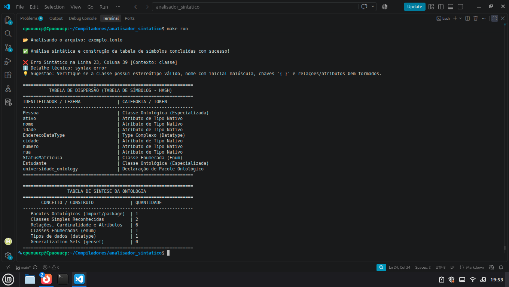

# Compilador e Analisador Sintático da Linguagem TONTO

## 📋 Sobre o Projeto
Desenvolvimento de um analisador léxico e sintático para a linguagem **TONTO** (Textual Ontology Language), baseado na especificação EBNF oficial, utilizando as ferramentas **Flex** e **Bison** integradas com **C++17**.

---

## 🛠️ Arquitetura da Tabela de Dispersão (Symbol Table)
Conforme exigido pelo Requisito 2, a tabela de símbolos do compilador foi implementada utilizando a estrutura de dados de dispersão `std::unordered_map<std::string, std::string>` da Standard Template Library (STL) do C++.

* **Funcionamento:** Cada identificador capturado pelo analisador (seja classe, pacote, enumeração, datatype ou relação) serve como **Chave (`string`)** única na tabela hash. O **Valor (`string`)** armazena o metadado descritivo do construto ontológico correspondente (ex: *"Classe Ontológica (Simples)"*, *"Atributo Interno"*, *"Pacote Ontológico"*).
* **Vantagens da Escolha:**
  * Complexidade de busca e inserção de tempo médio $O(1)$.
  * Eliminação automática de duplicatas de chaves no escopo global.
  * Facilidade na geração formatada do relatório final de símbolos.

---

## 🚀 Como Compilar e Executar

1. **Compilar o Projeto:**
   Certifique-se de que possui o `flex`, `bison`, `g++` e `make` instalados e execute no terminal:
   ```bash
   analisador_sintatico$ make run

2. Exemplo de Execução no Visual Studio Code
  

# Compilador e Analisador Sintático da Linguagem TONTO

Analisador léxico e sintático desenvolvido em **C++17** com **Flex** e **Bison** para a linguagem **TONTO** (*Textual Ontology Language*), baseado na especificação EBNF oficial, usando algumas convenções para nomear Instâncias, Classes, Atributos, Tipos Complexos e Relações.

Projeto desenvolvido para a disciplina de **Compiladores** da **Universidade Federal Rural do Semi-Árido (UFERSA)**.

---

## 📋 Funcionalidades e Construtos Suportados

O analisador realiza a verificação léxica e sintática de especificações ontológicas em TONTO, podendo suportar os seguintes construtos:

1. **Declaração e Importação de Pacotes (`package` e `import`):**
   * Reconhecimento de pacotes declarados e importados, atuando como escopos lógicos para classes e relações.
2. **Declaração de Classes Ontológicas:**
   * estereótipos como  (`kind`, `subkind`, `role`, `phase`, `category`, `mixin`, `roleMixin`, `phaseMixin`, `collective`, `relator`, `mode`, `quality`).
   * herança simples e múltipla por meio (via) `specializes`.
   * atributos tipados (nativos, complexos ou referências a classes), cardinalidades (`[1]`, `[0..*]`, `[1..*]`) e meta-atributos como (`{const}`, `{ordered}`, `{derived}`).
3. **Tipos de Dados Complexos (`datatype`):**
   * Definição de novos tipos estruturados compostos por atributos.
4. **Classes Enumeradas (`enum`):**
   * Declaração de enumerações com validação léxica de instâncias terminadas em sufixo numérico (ex: `Ativa01`, `Trancada02`).
   + Declaração de enumerações pode apresentar construto similar ao do nome da Classe (ex: `Azul`,`Amarelo`,`Vermelho`)
5. **Generalizações (`genset`):**
   * Suporte às restrições `disjoint`, `overlapping`, `complete` e `incomplete`.
   * Reconhecimento das sintaxes em linha (`where ... specializes`), em bloco (`{ general ... specifics ... }`) e declaração curta.
6. **Relações Internas e Externas:**
   * Suporte a relações internas com estereótipos (`@componentOf`, `@memberOf`, etc.), símbolos gráficos (`--`, `<>--`, `<o>--`) e cardinalidades.
   * Suporte a relações externas (`@mediation relation ...`) simples e nomeadas.

---

## 🏗️ Arquitetura do Projeto (Orientação a Objetos)

O projeto foi estruturado de forma modular para desacoplar a gramática do Bison do gerenciamento de estado e da tabela de símbolos:

```text
analisador_sintatico/
├── lexer.l                 # Especificação léxica (Flex) com rastreamento de linha/coluna
├── parser.y                # Gramática LALR(1) (Bison) com recuperação de erros
├── symbols_table.h         # Declaração das classes EscopoClasse, EscopoPacote e TabelaSimbolos
├── symbols_table.cpp       # Implementação da Tabela de Dispersão (Hash) e Tabela de Síntese
├── compiler_context.h      # Declaração da classe de contexto e relatório de erros
├── compiler_context.cpp    # Implementação do diagnóstico de erros léxicos e sintáticos
├── makefile                # Automação da geração e compilação em C++17
├── exemplo.tonto           # Ontologia universitária completa sem erros sintáticos
└── exemplo_com_erros.tonto # Arquivo de teste para validação da recuperação de erros
```

### Principais Classes
* **`TabelaSimbolos` (`symbols_table.h` / `.cpp`):**
  * Mantém uma **Tabela de Dispersão** (`std::unordered_map<std::string, std::string>`) para consulta rápida ($O(1)$) de identificadores e suas categorias ontológicas.
  * Mantém uma estrutura hierárquica (`EscopoPacote` $\rightarrow$ `EscopoClasse`) para gerar a **Tabela de Síntese**, detalhando quantidades e listando classes, atributos, relações internas/externas, datatypes, enums e gensets por pacote.
* **`CompilerContext` (`compiler_context.h` / `.cpp`):**
  * Encapsula o estado atual da compilação (nome do arquivo, linha, coluna exata do início do token, contexto sintático ativo e contador global de erros), eliminando variáveis globais soltas.

---

## 🛡️ Tratamento e Recuperação de Erros

* **Mensagens Contextuais:** O analisador informa o arquivo, a linha, a coluna inicial do token inesperado, o detalhe técnico gerado pelo Bison (`%define parse.error verbose`) e uma sugestão de correção adaptada ao contexto (`pacote`, `classe`, `atributo`, `datatype`, `enum`, `genset` ou `relacao`).
* **Análise Contínua (Recuperação de Erros):** Utilizando produções com o token `error` e sincronização via `yyerrok` / `yyclearin`, o analisador não interrompe a execução no primeiro erro. Ele percorre todo o arquivo (ou múltiplos arquivos em lote) e sempre exibe as tabelas consolidadas ao final.

---

## 🚀 Como Compilar e Executar

### Pré-requisitos
Certifique-se de ter instalados em seu ambiente Linux/WSL:
* `flex`
* `bison` (versão 3.0+)
* `g++` (com suporte a C++17)
* `make`

### Comandos

1. **Compilar o projeto:**
   ```bash
   Ctrl + Shift + B
   ```
   ou
   ```bash
   make
   ```

2. **Executar o teste padrão (`exemplo.tonto`):**
   ```bash
   make run
   ```

3. **Analisar um ou múltiplos arquivos `.tonto`:**
   ```bash
   ./analisador_sintatico_tonto exemplo.tonto exemplo_com_erros.tonto
   ```

4. **Modo interativo (entrada via teclado):**
   ```bash
   ./analisador_sintatico_tonto 
   ```
   *(Digite o código TONTO e pressione `Ctrl + D` para finalizar a análise)*.

5. **Limpar arquivos gerados automaticamente:**
   ```bash
   make clean
   ```

---

## 📊 Exemplo de Saída

Ao final da análise, o compilador exibe:
1. **Relatório de Erros Léxicos e Sintáticos** (caso existam), com arquivo, linha, coluna e sugestão de correção.
2. **Tabela de Dispersão (Hash):** Lista de todos os lexemas reconhecidos e suas respectivas classificações.
3. **Tabela de Síntese da Ontologia:** Resumo quantitativo global seguido do detalhamento hierárquico por pacote declarado e importado.
